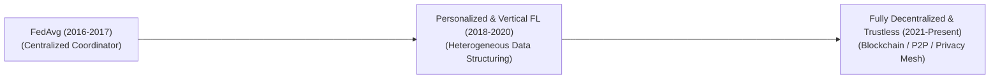

# 🚀 Awesome-Federated-Learning 🌟

  
   
       

---

## 🧠 Federated Learning (FL): Evolution, Variants, Types, & Applications

Welcome to the most comprehensive and **SEO-optimized** repository for **Federated Learning (FL)**, **Decentralized AI**, **Privacy-Preserving Machine Learning (PPML)**, and **Collaborative Edge Intelligence**! 📚✨

Federated Learning is a distributed machine learning framework that enables multiple client devices (e.g., mobile phones, hospitals, autonomous vehicles, IoT sensors, financial institutions) to collaboratively train a shared global model without ever centralizing raw data. Instead of uploading private and sensitive records to a centralized cloud datacenter, global model weights or gradients are transmitted to edge nodes, trained locally on private datasets, and aggregated into a unified model—preserving data sovereignty, regulatory compliance (GDPR, HIPAA, CCPA), and confidentiality by design.

---

## 📑 Table of Contents

- [⏳ 1. The Chronological Evolution](#-1-the-chronological-evolution)
- [🏗️ 2. Structural & Data Partitioning Variants](#️-2-structural--data-partitioning-variants)
- [🌐 3. Network Architecture & Scaling Types](#-3-network-architecture--scaling-types)
- [🔐 4. Advanced Security & Privacy Adapters](#-4-advanced-security--privacy-adapters)
- [🏭 5. Production Real-World Applications](#-5-production-real-world-applications)
- [☁️ 6. Top SaaS & Hosted Platforms](#️-6-top-saas--hosted-platforms)
  - [📊 Sector Overview & Market Dynamics](#-sector-overview--market-dynamics)
  - [🏢 Enterprise SaaS Matrix](#-enterprise-saas-matrix)
- [💻 7. Top Open-Source GitHub Frameworks](#-7-top-open-source-github-frameworks)
- [🤝 8. How to Contribute](#-8-how-to-contribute)
- [☕ 9. Support & Community](#-9-support--community)
- [⭐️ 10. Star History](#️-10-star-history)
- [⚠️ 11. Disclaimer](#️-11-disclaimer)

---

## ⏳ 1. The Chronological Evolution

The progression of Federated Learning reflects a transition from simple cloud-coordinated heuristic aggregation to highly adaptive, decentralized, heterogeneous, and cryptographic-hardened ecosystems.

| Era | Concept & Breakthrough | Year First Used | Seminal Paper Link |
| :--- | :--- | :--- | :--- |
| [**The Foundation Era (FedAvg)**](pages/FedAvg.md) 🏛️ | Introduced by Google researchers. Synchronous rounds of local Stochastic Gradient Descent (SGD) on client devices, followed by weighted parameter averaging on a central coordinator server. | 2016 | [McMahan et al. (AISTATS)](https://arxiv.org/abs/1602.05629) |
| [**The System Heterogeneity Era**](pages/System_Heterogeneity.md) ⚡ | Developed to handle Non-IID (not identically and independently distributed) data distributions and varying client hardware speeds, introducing tracking algorithms like FedProx and SCAFFOLD to prevent client drift. | 2018 | [Li et al. (MLsys)](https://arxiv.org/abs/1812.06127) |
| [**The Fully Decentralized & Trustless Era**](pages/Fully_Decentralized.md) ⛓️ | Eliminates the single point of failure (central server). Clients communicate over peer-to-peer (P2P) mesh networks, leveraging blockchain smart contracts or gossip protocols for Byzantine-fault-tolerant aggregation. | 2018 | [Lalitha et al. (NeurIPS Workshop)](https://arxiv.org/abs/1802.08722) |

---

## 🏗️ 2. Structural & Data Partitioning Variants

These variants define how data is distributed across participating nodes based on the overlap of sample spaces (users/rows) and feature spaces (variables/columns).

| Variant | Mechanism & Architecture | Real-World Enterprise Example | Year | Seminal Paper |
| :--- | :--- | :--- | :--- | :--- |
| [**Horizontal Federated Learning (Sample-Based)**](pages/Horizontal_FL.md) ↔️ | Datasets share the exact same feature schema but differ in sample IDs. | Two regional banks training a joint fraud detection model across disjoint customer bases. | 2019 | [Yang et al.](https://arxiv.org/abs/1902.04885) |
| [**Vertical Federated Learning (Feature-Based)**](pages/Vertical_FL.md) ↕️ | Datasets share overlapping sample IDs (entities) but differ in feature spaces. | A municipal bank and an e-commerce platform in the same region combining credit scores with shopping habits. | 2019 | [Yang et al.](https://arxiv.org/abs/1902.04885) |
| [**Federated Transfer Learning (FTL)**](pages/Federated_Transfer_Learning.md) 🔀 | Neither sample IDs nor feature spaces have substantial overlap across clients. | Cross-border collaboration between a European cancer institute and an Asian genomic research lab. | 2019 | [Liu et al.](https://arxiv.org/abs/1902.04885) |

---

## 🌐 3. Network Architecture & Scaling Types

These types define system-level topology, hardware capabilities, and communication constraints of participating processing units.

| Type | Scale & Topology | Hardware & Communication Constraints | Year | Seminal Paper |
| :--- | :--- | :--- | :--- | :--- |
| [**Cross-Device Federated Learning**](pages/Cross_Device_FL.md) 📱 | Scales to millions of consumer edge devices (smartphones, smart home hubs, IoT sensors). | High client churn, variable bandwidth, battery and thermal limits, asynchronous aggregation. | 2019 | [Kairouz et al.](https://arxiv.org/abs/1912.04977) |
| [**Cross-Silo Federated Learning**](pages/Cross_Silo_FL.md) 🏢 | Involves 2 to 100 enterprise organizations (hospitals, banks, aerospace consortia). | Reliable high-speed fiber networks, multi-GPU servers, high regulatory compliance, strict audit trails. | 2019 | [Kairouz et al.](https://arxiv.org/abs/1912.04977) |

---

## 🔐 4. Advanced Security & Privacy Adapters

While Federated Learning prevents raw data centralization, gradient updates can still leak confidential records through model inversion and membership inference attacks. These adapters fortify the learning pipeline.

| Security Adapter | Cryptographic Mechanism | Threat Model Defended | Year | Seminal Paper |
| :--- | :--- | :--- | :--- | :--- |
| [**Differential Privacy (DP-FL)**](pages/Differential_Privacy.md) 🛡️ | Adds calibrated Gaussian or Laplacian perturbation noise to local weight updates before central aggregation. | Prevents model inversion and reconstruction attacks. | 2017 | [Geyer et al.](https://arxiv.org/abs/1712.07557) |
| [**Secure Multi-Party Computation (SMPC)**](pages/SMPC.md) 🔑 | Employs Shamir's Secret Sharing or garbled circuits so the aggregator only reconstructs sum totals. | Prevents honest-but-curious server from inspecting individual gradients. | 2017 | [Bonawitz et al.](https://eprint.iacr.org/2017/281) |
| [**Trusted Execution Environments (TEE-FL)**](pages/TEE_FL.md) 🔒 | Runs model aggregation and decryption inside hardware-isolated enclaves (e.g., Intel SGX, AMD SEV). | Protects against root-privileged insiders and hypervisor intrusions. | 2020 | [Mo et al.](https://arxiv.org/abs/2104.14380) |

---

## 🏭 5. Production Real-World Applications

| Domain | Application Description | Impact & Regulatory Compliance | Year | Clinical/Industrial Link |
| :--- | :--- | :--- | :--- | :--- |
| **Mobile & Consumer** 📱 | [**Smart Keyboard Next-Word Prediction**](pages/Smart_Keyboard.md) | Gboard and iOS predict next tokens locally without logging user keystrokes to remote servers. | 2018 | [Hard et al.](https://arxiv.org/abs/1811.03604) |
| **Healthcare & Oncology** 🏥 | [**De-Identified Medical Image Diagnostics**](pages/Medical_Image.md) | Global hospitals train federated models for glioblastoma, rare tumours, and COVID-19 detection. | 2020 | [Rieke et al. (Nature)](https://www.nature.com/articles/s41746-020-00323-1) |
| **Automotive & Robotics** 🚗 | [**Autonomous Fleet Learning**](pages/Autonomous_Fleet.md) | Connected self-driving vehicle fleets train edge-case perception models locally during nightly depot charging. | 2018 | [Samarakoon et al.](https://arxiv.org/abs/1807.08127) |

---

## ☁️ 6. Top SaaS & Hosted Platforms

### 📊 Sector Overview & Market Dynamics

The global **Federated Learning Market** is estimated at **$140M–$160M in 2024** and is projected to surpass **$3.6B by 2032**, expanding at a compound annual growth rate (**CAGR**) of **~31.5%**, propelled by tightening global data privacy legislation (GDPR, HIPAA, EU AI Act) and the surge in decentralized edge computing.

The sector is currently **moderately to highly fragmented** rather than a winner-take-all monopoly: distinct market sub-segments are led by specialized champions—such as **Owkin** and **Rhino Health** dominating biopharma and clinical consortia, **NVIDIA** and **IBM** anchoring enterprise GPU compute and multi-cloud data fabrics, and **Flower Labs**, **FedML**, and **EdgeDelta** catering to developer-first serverless edge orchestration and streaming observability.

### 🏢 Enterprise SaaS Matrix

The table below catalogs leading commercial and hosted federated learning solutions, sorted in descending order by parent company scale (valuation or market capitalization):

| Platform / Company | Company Size (Valuation / Revenue) | Starting Pricing | Free Tier Limits & Trial Period | Key Features & Architecture Focus |
| :--- | :--- | :--- | :--- | :--- |
| **[NVIDIA AI Enterprise (Clara / FLARE)](https://www.nvidia.com/en-us/clara/)** 🟢 | **~$3.3T–$4.5T Market Cap** *(FY25 Rev: $130.5B)* | **$4,500 / GPU / year** list subscription (or **$1.00 / GPU / hour** via AWS, Azure, & GCP cloud marketplaces) | **90-Day Free Trial** evaluation license for full AI Enterprise stack (including NIM microservices & FLARE runtime) + free NGC developer sandbox access on `build.nvidia.com` | Healthcare AI, MONAI imaging integrations, production cross-silo FL, vertical and horizontal workflows. |
| **[IBM watsonx.ai (Federated Learning)](https://www.ibm.com/products/federated-learning)** 🔵 | **~$275B Market Cap** *(FY25 Rev: $67.5B)* | **$1.02 / Capacity Unit Hour (CUH)** on Essentials pay-as-you-go; Professional Studio plans from **$1,050 / month** | **Forever-Free "Lite Plan"** capped at 10 to 20 CUH/month, 1 authorized user, 1 instance, 25 GB cloud object storage, and 300,000 foundation model tokens/month | Enterprise AI governance, Cloud Pak for Data fabric, cryptographic aggregation, banking and financial compliance. |
| **[Owkin Substra Enterprise](https://www.owkin.com/)** 🦄 | **$1.46B Valuation** *(Series B Unicorn)* *(Est. Rev: $35M–$50M)* | **$50,000 / deployment** for structured biopharma research pilots; multi-center annual licenses from **$250,000 / year** | **30-Day Proof-of-Concept (PoC) Trial** for qualifying academic medical centers and life sciences consortia with dedicated onboarding support | Clinical trial optimization, MELLODDY drug discovery, multi-hospital histology and genomics collaboration. |
| **[EdgeDelta](https://edgedelta.com/)** ⚡ | **~$350M Valuation** *(Series B)* *(Est. Rev: $10M–$14M)* | **$50 / month** base for Pro; unlimited pipeline throughput is **$0.00**; Cloud search/retention starts at **$0.05 / GB** | **Forever-Free Community Plan** with unlimited streaming telemetry pipeline throughput + 10 GB/day index/storage retention limit and live interactive sandbox demo | Federated telemetry, distributed on-node streaming analytics, edge anomaly detection, zero raw data ingestion costs. |
| **[Flower Labs (Flower SuperGrid)](https://flower.ai/)** 🌸 | **$100M Valuation** *(Series A)* *(Est. ARR: ~$5M)* | **$17 / month** (billed annually) or **$20 / month** (billed monthly) for SuperGrid Pro tier | **Forever-Free Tier** with **3,000 free sign-up credits** on Flower Hub, unlimited public federations, and access to local/simulated runtimes | Framework-agnostic (PyTorch, TF, JAX, Hugging Face, Scikit-learn), managed serverless infrastructure, confidential compute. |
| **[FedML (FedML Nexus AI)](https://fedml.ai/)** 🚀 | **~$85M Valuation** *($11.5M Seed)* *(Est. ARR: ~$4M)* | **$29 / user / month** base platform license + on-demand GPU training instances starting at **$0.40 / GPU / hour** (RTX 4090) up to **$2.49 / GPU / hour** (A100/H100) | **Forever-Free Tier** with access to community Job Store templates, open-source SDK, and **5 free GPU compute trial hours** upon registration | Unified cross-cloud scheduler (FedML Launch), edge mobile FL (Android/iOS), MLOps pipelines, distributed LLM fine-tuning. |
| **[Rhino Health (Rhino FCP)](https://www.rhinohealth.com/)** 🦏 | **~$75M Valuation** *(Series A)* *(Est. Rev: ~$4.8M)* | **$25,000** for a single multi-site pilot project (or **$2,500 / node / month** via AWS Marketplace private contract offers) | **30-Day Guided Pilot Evaluation** for qualifying hospital/biotech teams with 2 connected mock hospital edge nodes and simulated EHR data | Federated Computing Platform (FCP), EXAM study pedigree, HIPAA/GDPR health data networks, distributed real-world evidence (RWE). |
| **[Apheris Compute Gateway](https://www.apheris.com/)** 🛡️ | **~$36M Valuation** *(Series A)* *(Est. Rev: ~$6.7M)* | **$15,000 / quarter** (**$5,000 / month**) entry contract tier for cross-enterprise compute gateway deployments | **14-Day Sandboxed Interactive Demo** with synthetic multi-partner governance simulation and compliance validation for enterprise security teams | Multi-partner governance, zero-trust cryptographic audit trails, manufacturing and biopharma IP collaboration. |

---

## 💻 7. Top Open-Source GitHub Frameworks

Curated collection of top open-source repositories for self-hosted federated learning, privacy-preserving machine learning, and decentralized model training. **Sorted descending by GitHub Stars_Count**:

| Framework & Repository | GitHub_Stars | Primary Language / Ecosystem | Description & Architectural Highlights | License |
| :--- | :--- | :--- | :--- | :--- |
| **[PySyft](https://github.com/OpenMined/PySyft)** 🔐 |  | Python • PyTorch | OpenMined's flagship library for secure, private deep learning. Decouples private data from model training using Multi-Party Computation (MPC), Differential Privacy, and Homomorphic Encryption primitives. | Apache 2.0 |
| **[Flower](https://github.com/adap/flower)** 🌸 |  | Python • Agnostic | The industry standard framework-agnostic FL framework. Seamlessly interoperates with PyTorch, TensorFlow, JAX, Hugging Face, Scikit-learn, and MLX. Supports massive scalability from mobile edge devices to multi-GPU clusters. | Apache 2.0 |
| **[FATE](https://github.com/FederatedAI/FATE)** 🏛️ |  | Python • C++ | Federated AI Technology Enabler initiated by WeBank and hosted by the Linux Foundation. An industrial-grade framework supporting horizontal and vertical federated learning with multi-party cryptographic acceleration. | Apache 2.0 |
| **[FedML](https://github.com/FedML-AI/FedML)** 🚀 |  | Python • PyTorch | Unified and scalable ML library for large-scale distributed training, model serving, and federated learning across cross-device (Android/iOS/IoT) and cross-silo enterprise setups. Includes FedNLP, FedCV, and FedLLM suites. | Apache 2.0 |
| **[TensorFlow Federated (TFF)](https://github.com/tensorflow/federated)** 🧠 |  | Python • TensorFlow | Google's research foundation for machine learning computations on decentralized data. Features the high-level Federated Learning (FL) API and low-level Federated Core (FC) API for novel distributed algorithm development. | Apache 2.0 |
| **[PFLlib](https://github.com/TsingZ0/PFLlib)** 📚 |  | Python • PyTorch | A 30+ personalized federated learning (PFL) algorithm benchmark library. Simulates non-IID and heterogeneous clients with plug-and-play implementations (Per-FedAvg, pFedMe, FedRep, DitTo, and FedBABU). | MIT |
| **[FederatedScope](https://github.com/alibaba/FederatedScope)** 🌐 |  | Python • PyTorch | Alibaba's event-driven federated learning platform. Features rich support for personalized FL, federated graph neural networks (FedGNN), differential privacy, and asynchronous message-passing topologies. | Apache 2.0 |
| **[Federated-Learning-PyTorch](https://github.com/AshwinRJ/Federated-Learning-PyTorch)** ⚡ |  | Python • PyTorch | Clean, educational PyTorch implementation of Google's seminal paper *"Communication-Efficient Learning of Deep Networks from Decentralized Data"* (FedAvg) on Non-IID MNIST and CIFAR-10. | MIT |
| **[NVIDIA FLARE](https://github.com/NVIDIA/NVFlare)** 🟢 |  | Python • PyTorch/TensorFlow | NVIDIA Federated Learning Application Runtime Environment. Production-ready SDK engineered for high-throughput enterprise and clinical consortia. Integrates Controller/Worker execution models and MONAI support. | Apache 2.0 |
| **[OpenFL](https://github.com/securefederatedai/openfl)** 🛡️ |  | Python • Intel LF AI | Intel-incubated LF AI & Data framework for secure federated AI. Features a Workflow API inspired by Metaflow and an integrated Privacy Meter to quantify membership inference leakage risks. | Apache 2.0 |
| **[FedLab](https://github.com/SMILELab-FL/FedLab)** 🔬 |  | Python • PyTorch | Lightweight, highly modular federated learning framework developed by SMILE Lab. Provides clean abstractions for network communication, simulation, and real-world deployment across distributed clusters. | Apache 2.0 |
| **[IBM Federated Learning](https://github.com/IBM/federated-learning-lib)** 🔵 |  | Python • Multi-framework | IBM's enterprise-grade Python library for federated learning in hostile or untrusted environments. Supports complex aggregators, topology configurations, and integration with IBM Watson Studio. | Apache 2.0 |
| **[PaddleFL](https://github.com/PaddlePaddle/PaddleFL)** 🛶 |  | Python • PaddlePaddle | Baidu's federated learning framework built on PaddlePaddle. Enables replication of distributed training algorithms across computer vision, natural language processing, and recommendation systems. | Apache 2.0 |
| **[Substra](https://github.com/Substra/substra)** 🏥 |  | Python • LF AI & Data | Originally created by Owkin and hosted by Linux Foundation AI & Data. A clinical production-proven federated learning software suite featuring advanced auditability, web UI tracking, and cross-hospital orchestration. | Apache 2.0 |
| **[MedPerf](https://github.com/mlcommons/medperf)** 🩺 |  | Python • MLCommons | An open-source framework by MLCommons for benchmarking medical AI models on decentralized clinical datasets in a vendor-neutral, auditable, and privacy-preserving manner. | Apache 2.0 |
| **[Fed-BioMed](https://github.com/fedbiomed/fedbiomed)** 🧬 |  | Python • PyTorch | An open-source biomedical research framework empowering non-centralized statistical and machine learning analyses across healthcare clinics and academic hospital sites. | Apache 2.0 |

---

## 🤝 8. How to Contribute

Contributions are warmly welcomed! Help make this repository the definitive resource for the global federated learning community:

1. 🍴 **Fork the repository** on GitHub.
2. 🌿 **Create a new branch** (`git checkout -b feature/awesome-addition`).
3. 📝 **Add or update entries** following our established table schemas, including specific pricing, free tier limits, Stars_Badges, and links.
4. ✅ **Ensure code and link integrity**: Keep descriptions objective, factual, and backed by seminal literature or official documentation.
5. 🚀 **Submit a Pull Request** with a concise description of your additions.

---

## ☕ 9. Support & Community

Thank you so much for exploring and supporting **Awesome-Federated-Learning**! ❤️

Building and maintaining this open knowledge repository requires continuous curation, paper verification, and ecosystem tracking. If this repository helped you in your research, production architecture, or commercial deployment:

- ⭐ **Star this repository** to boost visibility and help others discover it.
- 🍴 **Fork it** and build your own specialized federated workflows.
- 📢 **Share it** on Twitter/X, LinkedIn, Discord, and Reddit with fellow researchers and ML engineers.
- ☕ **Support ongoing development & sponsor the creator**: You can buy a coffee or sponsor through the **[GitHub Sponsors Dashboard](https://github.com/sponsors/ishandutta2007)**!

  

---

## ⭐️ 10. Star History

---

## ⚠️ 11. Disclaimer

- This repository is a **community-curated guide** intended for research, academic exploration, and architectural planning; it does not constitute financial, investment, or legal compliance advice.
- Federated learning architectures exhibit substantial variations in mathematical privacy guarantees (e.g., $(\epsilon, \delta)$-differential privacy bounds, additive homomorphic encryption key sizes, secure aggregation drop-out resilience). Always conduct thorough penetration testing and cryptographic audits before deploying models on sensitive or regulated production data.
- Third-party SaaS valuations, pricing tiers, and trial limits reflect publicly reported commercial listings and venture disclosures as of October 2026 and remain subject to change by their respective providers.

---

  Maintained with ❤️ by <a href="https://github.com/ishandutta2007">Ishan Dutta</a> and the open-source privacy-preserving AI community.

