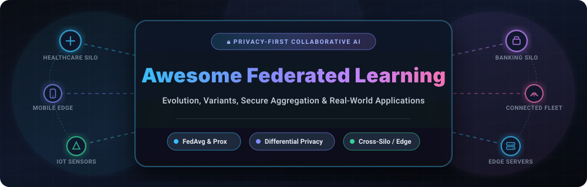
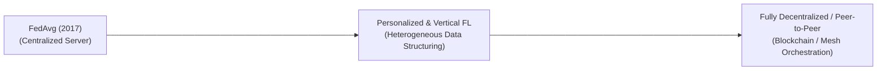

# 🚀 Awesome-Federated-Learning 🌟

  
   
  
  

## 🧠 Federated Learning (FL): Evolution, Variants, Types, & Applications

Welcome to the most comprehensive and **SEO-optimized** repository for **Federated Learning (FL)** resources, variants, and applications! 📚✨

Federated Learning is a decentralized machine learning paradigm that enables multiple client devices (e.g., mobile phones, hospitals, IoT devices) to collaboratively train a shared model without ever centralizing their raw data. Instead of moving private data to a central cloud server, the model weights or gradients are sent to the devices, updated locally, and aggregated centrally, preserving data privacy by design.

---

## ⏳ 1. The Chronological Evolution

The progression of Federated Learning reflects a transition from simple cloud-coordinated heuristic aggregation to highly adaptive, decentralized, and security-hardened ecosystems.

| Era | Concept | Year First Used | Paper Link |
| :--- | :--- | :--- | :--- |
| [**The Foundation Era (FedAvg)**](pages/FedAvg.md) | Introduced by Google. Synchronous rounds of local Stochastic Gradient Descent (SGD) on client devices, followed by an unweighted or weighted averaging of model updates on a central coordinator server. | 2016 | [McMahan et al.](https://arxiv.org/abs/1602.05629) |
| [**The System Heterogeneity Era**](pages/System_Heterogeneity.md) | Developed to handle Non-IID (not identically and independently distributed) data distributions and varying client hardware speeds, introducing tracking algorithms like FedProx and Scaffold to prevent model divergence. | 2018 | [Li et al.](https://arxiv.org/abs/1812.06127) |
| [**The Fully Decentralized & Trustless Era**](pages/Fully_Decentralized.md) | Eliminates the central coordinator server entirely. Clients communicate over a peer-to-peer mesh network, often utilizing blockchain ledgers or smart contracts to manage trust, consensus, and model aggregation. | 2018 | [Lalitha et al.](https://arxiv.org/abs/1802.08722) |

---

## 🏗️ 2. Structural & Data Partitioning Variants

These variants define how data is distributed across different nodes in the network based on the overlap of sample spaces and feature spaces.

| Variant | Mechanism & Example | Year First Used | Paper Link |
| :--- | :--- | :--- | :--- |
| [**Horizontal Federated Learning (Sample-Based)**](pages/Horizontal_FL.md) | **Mechanism:** Datasets share the exact same feature space but differ significantly in their sample IDs. **Example:** Two regional banks training a joint fraud detection system. Both banks collect identical metrics (income, transactions) but own completely different, distinct customer bases. | 2019 | [Yang et al.](https://arxiv.org/abs/1902.04885) |
| [**Vertical Federated Learning (Feature-Based)**](pages/Vertical_FL.md) | **Mechanism:** Datasets share overlapping sample IDs but differ in their feature spaces. **Example:** A local bank and an e-commerce company in the same city. They share many of the same customers, but the bank holds financial history while the e-commerce company holds retail buying history. | 2019 | [Yang et al.](https://arxiv.org/abs/1902.04885) |
| [**Federated Transfer Learning (FTL)**](pages/Federated_Transfer_Learning.md) | **Mechanism:** Applied when both the sample IDs and the feature spaces have very little overlap across clients. Uses deep transfer learning to map the distinct feature spaces into a shared, hidden representation layer before executing federated calculations. | 2019 | [Yang et al.](https://arxiv.org/abs/1902.04885) |

---

## 🌐 3. Network Architecture & Scaling Types

These types define the system-level topology and physical distribution of the participating processing units.

| Type | Topology & Constraints | Year First Used | Paper Link |
| :--- | :--- | :--- | :--- |
| [**Cross-Device Federated Learning**](pages/Cross_Device_FL.md) | **Topology:** Scales to millions of highly unstable, resource-constrained mobile or IoT devices. **Constraints:** Communication must be asynchronous, and the system must survive high client dropout rates (churn) since devices frequently lose network connections or power. | 2019 | [Kairouz et al.](https://arxiv.org/abs/1912.04977) |
| [**Cross-Silo Federated Learning**](pages/Cross_Silo_FL.md) | **Topology:** Involves a small, fixed number of highly reliable institutional organizations (e.g., 5 to 20 medical centers or financial institutions). **Constraints:** All clients are almost always online, possess immense computing infrastructure, and require rigorous compliance and audit trails. | 2019 | [Kairouz et al.](https://arxiv.org/abs/1912.04977) |

---

## 🔐 4. Advanced Security & Privacy Adapters

While Federated Learning keeps raw data local, model gradients can still leak private information through reverse-engineering attacks. These variants augment FL with cryptographic boundaries.

| Adapter | Mechanism | Year First Used | Paper Link |
| :--- | :--- | :--- | :--- |
| [**Differential Privacy (DP) Federated Learning**](pages/Differential_Privacy.md) | Adds mathematical Gaussian or Laplacian noise directly to local gradients before sending them to the aggregator. This guarantees that an adversary cannot deduce whether a specific individual's data was used in training. | 2017 | [Geyer et al.](https://arxiv.org/abs/1712.07557) |
| [**Secure Multi-Party Computation (SMPC)**](pages/SMPC.md) | Uses cryptographic secret sharing protocols. The central server can only see the combined, aggregated total of all client updates, keeping individual client weight updates completely unreadable during transit. | 2017 | [Bonawitz et al.](https://eprint.iacr.org/2017/281) |
| [**Trusted Execution Environments (TEE-FL)**](pages/TEE_FL.md) | Directs the aggregation phase to execute inside secure, hardware-isolated memory enclaves (like Intel SGX) on the cloud server, protecting the global model from being compromised by cloud provider insiders. | 2020 | [Mo et al.](https://arxiv.org/abs/2104.14380) |

---

## 🏭 5. Production Real-World Applications

| Application | Description | Year First Used | Paper Link |
| :--- | :--- | :--- | :--- |
| [**Smart Keyboard Next-Word Prediction**](pages/Smart_Keyboard.md) | Modern smartphones collaboratively train autocomplete and text correction models locally on user devices without sending private chats, keys, or text entries back to a corporate cloud. | 2018 | [Hard et al.](https://arxiv.org/abs/1811.03604) |
| [**De-Identified Medical Image Diagnostics**](pages/Medical_Image.md) | Hospitals worldwide train a unified deep neural network to detect rare tumors by aggregating model updates across silos, successfully bypassing strict medical data privacy laws (like HIPAA or GDPR). | 2020 | [Rieke et al.](https://www.nature.com/articles/s41746-020-00323-1) |
| [**Autonomous Fleet Learning**](pages/Autonomous_Fleet.md) | Self-driving vehicle fleets process edge-case driving data locally on their internal hardware boards overnight, uploading compressed structural model adjustments over Wi-Fi to improve global object detection arrays simultaneously. | 2018 | [Samarakoon et al.](https://arxiv.org/abs/1807.08127) |

## ⭐️ Star History

<a href="https://www.star-history.com/?repos=ishandutta2007/Awesome-Federated-Learning&type=date&legend=bottom-right">
<picture>
<source media="(prefers-color-scheme: dark)" srcset="https://api.star-history.com/chart?repos=ishandutta2007/Awesome-Federated-Learning&type=date&theme=dark&legend=bottom-right" />
<source media="(prefers-color-scheme: light)" srcset="https://api.star-history.com/chart?repos=ishandutta2007/Awesome-Federated-Learning&type=date&legend=bottom-right" />

</picture>
</a>

# Awesome-Federated-Learning

## Top Federated Learning Ecosystem

**Curated List of SaaS Products & Open-Source GitHub Projects**  

*Focused on Privacy-Preserving Collaborative Training, Decentralized Data & Self-Hosted FL Frameworks*  

**Last updated: October 2026**

This repository tracks notable **SaaS platforms** and **open-source projects** for **Federated Learning**. These tools enable multiple parties to collaboratively train machine learning models without centralizing raw data—critical for healthcare, finance, and any domain where data sovereignty and regulatory compliance are non-negotiable.

**Examples** include Flower, NVIDIA FLARE (Clara), IBM Federated Learning, Rhino Health, Owkin, FedML, PySyft, Substra, EdgeDelta, and Apheris (the category leaders).

**Open-source emphasis**: This section is heavily expanded with every major active project for self-hosting, healthcare-grade deployments, and transparent privacy guarantees—ideal for hospitals, research consortia, and enterprises that cannot centralize sensitive data. The open-source landscape is anchored by **TensorFlow Federated** (Google's research framework), **Flower** (framework-agnostic standard), **NVIDIA FLARE** (enterprise/regulated deployments), **Substra** (healthcare production-proven from Owkin), and **PySyft** (encrypted computation), with **FedML** bridging research and production and **OpenFL** (Intel) providing an alternative enterprise-grade option.

Contributions welcome! Open a PR to add/update entries. Keep descriptions factual and link to official sites.

## Table of Contents

- [SaaS/Hosted Platforms](#saas-hosted-platforms)

- [Open-Source GitHub Projects](#open-source-github-projects)

- [How to Contribute](#how-to-contribute)

- [Disclaimer](#disclaimer)

## SaaS/Hosted Platforms

- **[NVIDIA Clara](https://www.nvidia.com/en-us/clara/)**  

  NVIDIA's healthcare AI platform, with NVIDIA FLARE as its federated learning runtime. Clara provides domain-specific tooling for medical imaging and genomics, while FLARE handles the federated orchestration.

- **[Owkin](https://www.owkin.com/)**  

  AI biotech company that originated Substra and remains its primary contributor. Offers federated learning services for pharmaceutical research and clinical trials, with Substra as the underlying open-source foundation.

- **[Rhino Health](https://www.rhinohealth.com/)**  

  Federated learning platform specifically designed for healthcare and life sciences. Focuses on enabling multi-institutional collaboration while maintaining HIPAA and GDPR compliance. Commercial offering with healthcare-specific workflows.

- **[Flower (Cloud/Enterprise)](https://flower.ai/)**  

  Commercial tier of the Flower federated learning framework. Offers managed infrastructure and enterprise support for the open-source core. Flower is framework-agnostic and widely used in research.

- **[IBM Federated Learning](https://www.ibm.com/products/federated-learning)**  

  IBM's enterprise federated learning offering, integrated with IBM Cloud Pak for Data and Watson Studio. Supports both horizontal and vertical federated learning. Commercial support and integration with IBM's broader AI governance tooling.

- **[EdgeDelta](https://edgedelta.com/)**  

  Observability platform with edge processing capabilities. While not a pure federated learning platform, it supports distributed data processing at the edge, relevant for privacy-sensitive inference scenarios.

- **[Apheris](https://www.apheris.com/)**  

  Enterprise federated learning platform focused on regulated industries (healthcare, finance, manufacturing). Provides governance, audit trails, and compliance controls for multi-party data collaboration.

## Open-Source GitHub Projects

- **[TensorFlow Federated (TFF)](https://github.com/tensorflow/federated)**  

  Google's open-source framework for machine learning and other computations on decentralized data. TFF provides two layers: the **Federated Learning (FL) API** (`tff.learning`) for applying included federated training and evaluation to existing TensorFlow models, and the **Federated Core (FC) API** for expressing novel federated algorithms by combining TensorFlow with distributed communication operators . Includes a single-machine simulation runtime for experiments. Best for TensorFlow-centric research teams that want to experiment with novel FL algorithms and need fine-grained control over federated computation primitives.

- **[Flower](https://github.com/adap/flower)**  

  Framework-agnostic federated learning framework with a client-server abstraction that works with PyTorch, TensorFlow, JAX, scikit-learn, Hugging Face, PyTorch Lightning, fastai, MLX, XGBoost, and even Pandas for federated analytics . Widely adopted in research for its simplicity and flexibility. Flower Baselines provides community-contributed reproductions of popular FL publications (FedProx, FedNova, FedBN, FedMeta, and more) for researchers to build upon . Apache 2.0 licensed. Best for research and teams that want to avoid framework lock-in while maintaining access to state-of-the-art FL algorithms.

- **[NVIDIA FLARE](https://github.com/NVIDIA/NVFlare)**  

  NVIDIA Federated Learning Application Runtime Environment. Domain-agnostic Python SDK supporting horizontal and vertical federated learning, with peer-reviewed research implementations across medical imaging, federated optimization, privacy analysis, and large language models—including FedBPT (ICML 2024), ConDistFL (DeCaF 2023), FedBN (ICLR 2021), and privacy-preserving brain tumour segmentation (MLMI 2019) . Component-based architecture with Controller/Worker execution model and support for both simulation and production deployment. Apache 2.0 licensed. Best for enterprise and regulated deployments, including clinical use cases with a strong research track record.

- **[Substra](https://github.com/Substra/substra)**  

  The most proven open-source federated learning software designed for healthcare research . Originally developed by Owkin and now hosted by the Linux Foundation for AI and Data. Provides a flexible Python interface and web application for running FL training at scale. Has been deployed in production by hospitals and biotech companies (e.g., the MELLODDY project) . Apache 2.0 licensed across its repository ecosystem (substrafl, substra-backend, substra-frontend, orchestrator) . Best for healthcare consortia and production clinical research where regulatory compliance and real-world deployment are primary requirements.

- **[PySyft (OpenMined)](https://github.com/OpenMined/PySyft)**  

  A Python library for secure, private deep learning that decouples private data from model training using Multi-Party Computation (MPC) within PyTorch . Emphasizes privacy-preserving and encrypted computation over distributed data, rather than being purely a federated averaging framework. Apache 2.0 licensed. **Important caveat**: the project's own README historically stated "Do NOT use this code to protect data (private or otherwise) - at present it is very insecure" . Best for research and experimentation with privacy primitives, not production privacy guarantees without additional hardening.

- **[FedML](https://github.com/FedML-AI/FedML)**  

  Unified and scalable ML library for large-scale distributed training, model serving, and federated learning. Targets cross-device and cross-silo production workflows with a unified research library . 4,170+ GitHub stars, Apache 2.0 licensed. Includes specialized sub-projects: FedNLP (NAACL 2022), FedGraphNN (ICLR'21 workshops), FedCV (computer vision), FedIoT (on-device anomaly detection), and FedML-Mobile (Android/iOS) . Best for teams that want to bridge research experimentation and production federated learning across diverse domains.

- **[OpenFL (Intel)](https://github.com/securefederatedai/openfl)**  

  Open framework for federated learning, now hosted by LF AI & Data . Features a Workflow API (experimental) inspired by Metaflow for composing custom aggregator and collaborator tasks, plus a Privacy Meter based on membership inference attacks for evaluating privacy leakage . Includes tutorials for scikit-learn linear regression and PyTorch FedProx. Best for Intel-based research clusters and teams seeking an enterprise-oriented alternative to Flower with built-in privacy evaluation tooling.

### Additional Strong Open-Source Options

- **IBM Federated Learning (Community Edition)** — Free for non-commercial use, with built-in enterprise-strength features. Available at `IBM/federated-learning-lib` . Best for exploring IBM's FL approach before committing to the commercial offering.

- **Fed-BioMed** — Open-source project focused on empowering healthcare using non-centralized approaches for statistical analysis and machine learning, based on Python, PyTorch, and Scikit-learn . Best for healthcare research with a focus on medical imaging and clinical data.

- **FATE (WeBank)** — Federated AI Technology Enabler, widely used in Chinese enterprise deployments. Supports horizontal and vertical federated learning with privacy mechanisms including differential privacy and secure computation .

- **Frameworks for building custom systems**: Pair **Flower** for framework-agnostic orchestration with **Substra** for healthcare-grade production deployment. Use **NVIDIA FLARE** when enterprise support and a proven research track record in medical imaging are priorities. **TensorFlow Federated** provides the lowest-level primitives for novel algorithm development, while **PySyft** offers MPC-based encrypted computation for advanced privacy experiments. **OpenFL** bridges research and production with Intel's ecosystem and privacy evaluation tools.

## How to Contribute

1. Fork the repo.

2. Add/edit entries in `README.md` (follow existing format).

3. Include: name, link, 1–2 sentence description, and whether it's SaaS or open-source.

4. Submit PR with a short explanation.

Star the repo if you find it useful!

## Disclaimer

- This is a **community-curated** list — not exhaustive and not an endorsement.

- Federated learning frameworks vary significantly in privacy guarantees (differential privacy, homomorphic encryption, secure aggregation), healthcare compliance readiness, and operational complexity; evaluate against your regulatory requirements.

- PySyft's own documentation has historically warned against using it to protect sensitive data due to security limitations; verify current status before production use .

- Self-hosted solutions require proper PKI setup, network security, and audit logging to ensure that "privacy-preserving" claims hold in practice.

---

**Made for healthcare AI researchers, privacy engineers, data governance teams, and organizations building collaborative intelligence without centralizing sensitive data.**  

Let's make federated learning more open, auditable, and deployable in regulated environments.
